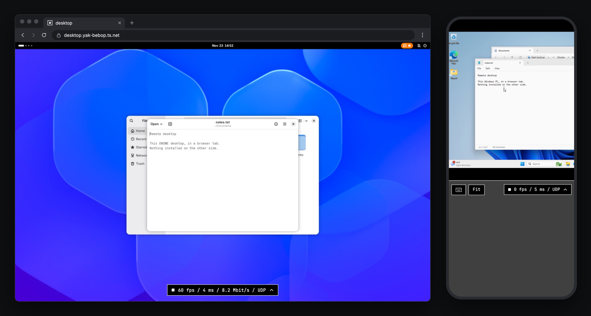

# Remote desktop

Your running Linux desktop, Mac or Windows PC in a browser tab. One binary on the host, nothing on the client.

- **Client:** a page the host serves. Chrome, installable as an app; on a phone a trackpad with a mouse's two
  buttons, pinch zoom and a bar of the keys its keyboard lacks.
- **Video:** H.264, or HEVC where both ends can, as WebTransport datagrams (QUIC) with spare packets against
  loss, over the WebSocket where UDP is blocked. NVENC or VA-API where the GPU encodes, x264 elsewhere.
- **Adaptive:** the bitrate follows the measured link. A still screen sends nothing and sharpens to full
  quality; motion that a low bitrate makes coarse is scaled down, and back when still. One control says what
  gives way, response or quality.
- **Complete:** sound (Opus), clipboard text, keyboard with system shortcuts, a pointer drawn by the client,
  choice of screen, the login screen. No configuration.
- **Direct:** browser to host over TLS. No account, no relay, no vendor's server.

## What it is not

- **Not a way around routers.** The client has to reach the host: over Tailscale, which it is made for, on
  the same network, or through a port you open.
- **Not a game streamer.** No gamepads, no HDR.
- **Not a session of its own.** It shows the machine's own screen, login screen included. The size Client
  gives it a screen of the browser window's size while connected: a virtual one on Hyprland and macOS, the
  display's own mode on X11 and, with its scale, on Windows, restored afterwards.
- **Not file transfer.** Clipboard text only.

## What it runs on

**Linux**, x86_64 and aarch64: any distribution, any desktop, Wayland or X11. The exceptions:

- No glibc 2.28 or newer (Alpine), or no foreign binaries as they are (NixOS, Guix).
- Wayland compositors other than GNOME, KDE, Hyprland and those built on wlroots, such as Sway, labwc and
  Wayfire: it needs `ext-image-copy-capture-v1` or `wlr-screencopy`.
- No sound without PipeWire or PulseAudio.

The GPU encodes with NVIDIA's driver 470 or newer (one viewer at a time), or through VA-API on Intel and AMD,
H.264 and HEVC. Text from a phone's keyboard is typed as text whatever the host's layout; GNOME's and KDE's
Wayland sessions, and X programs under Wayland, take it as keys of the desktop's keyboard, which has not
every character.

**macOS** 12.3 or newer on Apple Silicon, with x264; sound needs macOS 13. The size Client uses a virtual
display interface that is not public.

**Windows** 10 and 11 on x86_64, with x264 (NVENC is built in, untried), one viewer per display. Where a
driver draws the pointer into the picture and Windows cannot leave it out, the pointer comes with the video.
Not yet: the login screen, consent prompts, and input into programs that run as administrator.

**Client:** Chrome. It needs WebCodecs; Keyboard Lock, in full screen, for shortcuts such as Alt+Tab; and
WebTransport for video over UDP.

## Install

With Tailscale, the preferred way: a certificate browsers trust, reachable wherever the tailnet reaches,
nobody else answered. In a terminal of the desktop session to control:

    curl -fsSL https://github.com/timongentzsch/remote-desktop/releases/latest/download/install.sh | sh -s -- --tailscale

Without it, with a certificate each client has to trust once:

    curl -fsSL https://github.com/timongentzsch/remote-desktop/releases/latest/download/install.sh | sh

On Windows, in a terminal, with the same options:

    curl.exe -LO https://github.com/timongentzsch/remote-desktop/releases/latest/download/remote-desktop-x86_64-windows.exe
    .\remote-desktop-x86_64-windows.exe install

The script says which system it found and what the install will ask for, downloads the binary and runs
`remote-desktop install`:

| Option | |
|---|---|
| `--tailscale` | Certificate from Tailscale; only devices on the tailnet are answered (see [Certificates](#certificates)). |
| `--no-password` | No login password. With `--tailscale`, access is what the tailnet's rules allow. |
| `--port=N` | Another port than 443, where that is taken. Kept by later installs; the address ends in `:N`. |
| `--auto-update` | Newer versions install themselves (see [Updates](#updates)). Kept by later installs. Linux with systemd, and Windows. |

What it sets up:

| | Linux | macOS | Windows |
|---|---|---|---|
| Binary | `/usr/local/bin/remote-desktop` (sudo) | `/usr/local/bin/remote-desktop` (sudo) | `%LOCALAPPDATA%\Programs\remote-desktop\` |
| Started by | systemd user service, or the desktop's autostart | LaunchAgent | Run key, at logon |
| Password, certificate | `~/.config/remote-desktop/` | `~/Library/Application Support/remote-desktop/` | `%LOCALAPPDATA%\remote-desktop\` |
| Log | journal | `~/Library/Logs/remote-desktop.log` | with the password |
| Besides | udev rule for `/dev/uinput`; port in ufw or firewalld, TCP and UDP; system service for the login screen; with `--auto-update`, a path unit and a service that replace the binary as root | asks for Screen & System Audio Recording and Accessibility, again after each new version | firewall rule, with an administrator's consent |

`remote-desktop uninstall` removes all of it but the password and the certificate. Where Linux reserves low
ports, the binary gets `CAP_NET_BIND_SERVICE` through `setcap`, and with it ignores `LD_LIBRARY_PATH`; a port
from 1024 on needs neither.

The login screen is shown by the system service under the same address and password. At login it leaves the
port to the user's host, and the page reconnects by itself. Seen working with SDDM. It needs systemd and a
graphical login: without, let the display manager log the user in and lock the session at once.

    remote-desktop install [--tailscale] [--no-password] [--port=N] [--auto-update]
    remote-desktop uninstall
    remote-desktop update                      install the newest release, if it is newer
    remote-desktop password [--none]           set the login password, or allow access without one
    remote-desktop certificate [--tailscale]   make a new certificate, or switch where it comes from
    remote-desktop --listen 127.0.0.1:8765     run by hand on another address

Versions before 0.10 served on port 8765. Installing moves the host to 443 and removes the old firewall
rules; bookmarks and a tailnet's access rules need the new address.

## Updates

An installed host asks GitHub once a day for the newest release's `update` file: the version and the SHA-256
of each binary, signed with Ed25519. The public key is in the binary, the private one a secret of the workflow
that publishes releases. Only a signed list with a higher version counts, and only a binary with the listed
hash is installed. The menu on the page says when there is a newer version.

`remote-desktop update` installs it by hand, as `install` would. With `install --auto-update` the host does it
itself, while nobody is connected:

- **Linux:** the host writes the version it wants to `~/.config/remote-desktop/update`; a systemd path unit
  watches that file and starts `remote-desktop update` as root, which downloads and verifies for itself.
- **Windows:** the host starts `remote-desktop update` as the user.
- **macOS:** not unattended, as a new binary needs its permissions allowed again at the Mac.

If the host served before the binary changed and does not within 30 seconds after, the old binary is put back
and that version is not tried again. Deleting the `update` file among the settings switches this off.

Versions 0.11.0 and 0.11.1 take a newer version whose page has changed for one that does not serve, and put
themselves back: install over those by hand, as at first.

## Certificates

The host always serves HTTPS: browsers decode video and capture the keyboard on secure pages only.

**Tailscale (preferred).** `install --tailscale`, on a tailnet with HTTPS certificates enabled. Browsers trust
the certificate, it renews itself, and the address is `https://<machine>.<tailnet>.ts.net`. Headscale issues
such certificates from 0.30 on, with `dns.certificates` and a DNS challenge provider. The host then answers
Tailscale's addresses only (`100.64.0.0/10`, `fd7a:115c:a1e0::/48`) and the machine itself. Tailscale drops
those addresses on every other interface, and what a subnet router forwards does not count. Who may connect
is up to the tailnet's access rules.

**Self-signed.** What `install` makes otherwise: valid for 820 days, for the hostname and addresses the
machine had. Each client trusts it once; on a Mac:

    scp user@host:.config/remote-desktop/certificate.pem remote-desktop.pem
    security add-trusted-cert -r trustRoot -p ssl -k ~/Library/Keychains/login.keychain-db remote-desktop.pem

There is no relay and no router traversal. Where Tailscale relays two devices instead of connecting them
directly, that shows as delay: `tailscale ping <machine>` says which it is.

## Security

Whoever logs in controls the desktop session: treat the address and password like an SSH login.

- TLS throughout, QUIC for the video. The UDP port carries nothing without a token that only a logged-in
  session's page has.
- After a wrong password no login is accepted for a second, on any connection. Use a long password where
  untrusted networks reach the port, or Tailscale.
- The page keeps the password in the browser's local storage after a successful login.
- With `password --none`, whoever reaches the port controls the desktop. Other web sites cannot do so through
  a visitor's browser: the host accepts connections from its own page only.
- The udev rule lets every program of the user at the machine create input devices.
- The login-screen service answers before anyone has logged in, behind the same password. It is root until it
  has read the password and the certificate, then the display manager's user.
  `sudo systemctl disable --now remote-desktop-login` switches it off.
- The host listens on all interfaces unless started with `--listen`.
- With `--auto-update`, whoever can publish a release of this repository decides what runs on the host, on
  Linux also as root at the login screen.

## Build

Needs Rust, a C compiler, `make` and, for x86, `nasm`. Clone with `--recurse-submodules`: x264 is built from
`native/x264`, and `native/nv-codec-headers`, `native/libva` and `native/pipewire` provide headers for
libraries that are loaded at run time where present.

    cd native
    cargo fmt --check && cargo clippy --release --all-targets -- --deny warnings
    cargo test --release
    cargo build --release

Release binaries for glibc 2.28 and newer need `zig` and `cargo-zigbuild`; `.github/workflows/build.yml`
builds them and publishes them when a version tag is pushed.

    cargo zigbuild --release --target x86_64-unknown-linux-gnu.2.28 --target aarch64-unknown-linux-gnu.2.28

The Windows binary is built on Linux too, with mingw-w64 and the target `x86_64-pc-windows-gnu`:

    cargo build --release --target x86_64-pc-windows-gnu

## Layout

    install.sh                 the one-line install: fetches the binary, runs `remote-desktop install`
    index.html                 the client: page, styles and script in one file
    fonts/                     its typeface, JetBrains Mono, which the host serves along
    native/src/                what is the same on every operating system:
      main.rs                  the command line, and the names the rest shares
      server.rs                HTTPS and the client page, and who is answered
      session/                 one client's session: its login, threads and input, and its datagrams
      outbox.rs, ws.rs         what waits to be sent to a client; WebSocket framing
      quic.rs, fec.rs          the UDP side that video takes; its spare datagrams against loss
      rate.rs                  the bitrate a connection is given, from how well frames get through
      tls.rs, certificate.rs   the encrypted connection; the certificate behind it
      install.rs               install, uninstall, the password and the certificate; each platform's part
      update.rs                newer versions: looking for one, checking its signature, putting it in place
      capture.rs, screen.rs    what a session asks of a capture; the screens and where the pointer goes
      stream/                  pictures to video: pacing, size, colour detail, the encoders, the FLV they go in
      audio.rs                 the desktop's sound as Opus
      platform/                what differs from one operating system to another, behind one surface (mod.rs)
        linux/                 Wayland and X11 capture, PipeWire and PulseAudio, uinput, the clipboard,
                               the login screen, install with systemd, ufw and firewalld, the virtual screen
        macos/                 ScreenCaptureKit, CGEvent input, the virtual display, install as a LaunchAgent
        windows/               Desktop Duplication, SendInput, WASAPI, the clipboard, install from the Run key
    tests/                     the regression on every kind of desktop, and tools for measuring

To extend it: another operating system is a module in `platform/` that provides the names `platform/mod.rs`
lists; another way of capturing a screen on Linux is a module in `platform/linux/capture/` with one function,
`run`, that feeds a `Stream`, and another desktop's clipboard one in `platform/linux/clipboard/`; another
encoder implements `encoder_ops` in `stream/encoder.h`; and another kind of message gets its number in `ws.rs`
and a handler in the client's table of them. The client and the host share a protocol but no code: each value
they must agree on is named on both sides, with a note where the other side has it (`session/login.rs` for the
login, `ws.rs`, `stream/flv.rs` and `quic.rs` for the binary ones).

## Licence

GNU General Public License, version 2 or (at your option) any later version; see `LICENSE`. x264, which is
linked into the binary, is under the same terms. The client's typeface, JetBrains Mono, is under the SIL Open
Font License; see `fonts/OFL.txt`.
